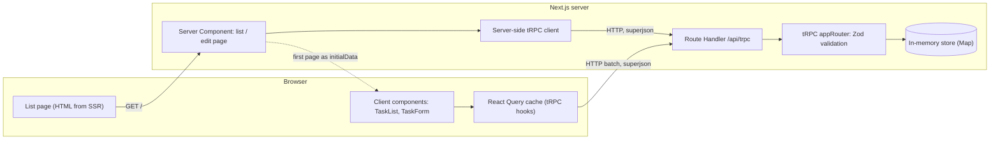

# Task Manager — Next.js 15 + tRPC

[](https://github.com/amanda-natallie/task-manager-trpc/actions/workflows/ci.yml)

A small task manager built for a technical challenge: a Next.js 15 (App Router) app
whose backend is a tRPC router that keeps tasks **in memory** (no database).

## Live demo

The app is deployed at [https://task-manager-trpc-zeta.vercel.app](https://task-manager-trpc-zeta.vercel.app). Pushes to `main` deploy to production automatically on Vercel.

The task list is stored in memory on the server. It is re-seeded with the example tasks whenever the serverless function restarts, so data created in the demo is not persisted. Serverless instances don't share memory, so if Vercel runs more than one instance of the API at the same time, a task created on one may briefly be missing on another. A database or KV store would remove this limit (see [Main decisions](#main-decisions)).

## Run it

```bash
npm install
npm run dev          # http://localhost:3000
npm test             # unit tests: router, form, list (Vitest)
npm run test:e2e     # end-to-end tests in Chromium (Playwright; builds and starts the app)
npm run lint         # ESLint (Next.js, TypeScript and jsx-a11y rules)
npm run typecheck    # tsc --noEmit
npm run build && npm start   # production build
```

The first `npm run test:e2e` needs the browser: `npx playwright install chromium`.

Requires Node.js 24 (or 22.22+, the minimum for the test tooling; tested on Node 24).
No environment variables or secrets are needed.

## What it does

- **Tasks** have `id` (UUID), `titulo` (required), `descricao` (optional) and `dataCriacao` (timestamp).
- **CRUD over tRPC**: `task.list`, `task.byId`, `task.create`, `task.update`, `task.delete`.
- **Validation**: Zod schemas on every procedure. Empty or whitespace-only titles are rejected
  (`BAD_REQUEST`); updating or deleting a missing task returns `NOT_FOUND` with a clear message.
- **List page (`/`)** is server-side rendered: the Server Component loads the first page through
  the tRPC API and passes it to the client as initial data, so tasks are in the first HTML response.
- **Delete** from the list (after a confirmation dialog), applied optimistically: the task disappears at once
  and comes back with an error message if the server call fails.
- **Create/edit form** (`/tasks/new`, `/tasks/[id]/edit`): functional components + hooks,
  client-side validation (title required) mirrored by the backend, server errors shown in the form.
- **Bonus: infinite scroll** with cursor-based pagination and an `IntersectionObserver` sentinel.
  25 fictional seed tasks are loaded at startup so the scroll can be seen.
- **Loading and error pages**: a loading state for the list and an error boundary for every page.
- **Dark UI**: plain CSS with a few design tokens (no UI framework), the Geist font through
  `next/font`, [Lucide](https://lucide.dev) icons, toasts for feedback, a native `<dialog>` for the
  delete confirmation, skeleton loading and custom error and 404 pages. Animations are turned off
  for users who prefer reduced motion.
- **Responsive** from small phones (~360px) to desktop: one column, form buttons stack on narrow
  screens, 44px tap targets on phones, no horizontal scrolling.
- **Accessible**: landmarks (`header`/`nav`/`main`), a skip link, visible keyboard focus, labelled
  inputs with errors linked through `aria-describedby`, icon buttons named with `aria-label`, live
  regions so success and error messages are announced by screen readers, and WCAG AA contrast.

## Architecture



- **First load (SSR)**: the Server Component loads the first page through a server-side tRPC client
  that calls `/api/trpc`, and passes it to `TaskList` as React Query's initial data.
- **After that (client)**: queries and mutations go through React Query and the tRPC client to
  `/api/trpc` too. Both paths share one endpoint, one set of procedures and one store.

**Trade-offs**

- **Why tRPC here**: frontend and backend live in one TypeScript repo, so sharing the router type
  gives end-to-end type safety with no schema files or code generation, and Zod input schemas are
  the single source of validation.
- **When I would not use it**: when the API has consumers outside this codebase (public API,
  mobile apps in other languages, other teams). tRPC is not a documented HTTP contract; REST with
  OpenAPI or GraphQL fits better there.
- **Swapping the store for a database**: all data access in the router goes through `store.ts`
  (the `store.tasks` Map, `sortedTasks` and `compareTasks`). Moving that behind a small repository (for example
  `list(cursor, limit)`, `get`, `create`, `update`, `delete`) backed by PostgreSQL changes the
  procedure bodies only; procedure names, inputs and outputs stay the same, so the client code
  doesn't change.

## Quality

- **CI** ([`.github/workflows/ci.yml`](.github/workflows/ci.yml)) runs on every push and pull request to
  `main`: type check, ESLint, unit tests, production build, then the Playwright E2E tests against that
  build.
- **Tests**: 14 unit tests (Vitest) and 6 E2E tests (Playwright: create, edit, delete with the confirm
  dialog, empty-title validation, a seeded task by its fixed id, 404 for a missing task).
- **Lighthouse** (local production build, Lighthouse 13): Performance 100 on desktop and 95–100 on
  mobile for `/` and `/tasks/new`, and 100 in Accessibility, Best Practices and SEO on both.

## Structure

```
src/
  server/
    store.ts            in-memory Map (one per server process, kept on globalThis)
    trpc.ts             tRPC init: superjson transformer + readable Zod errors
    routers/task.ts     task procedures (validation, errors, pagination)
    routers/_app.ts     root router + exported AppRouter type
    routers/task.test.ts  router tests (CRUD, validation, errors, pagination)
  trpc/
    client.tsx          React Query + tRPC provider for Client Components
    server.ts           server-side tRPC client used for SSR (calls /api/trpc)
  app/
    api/trpc/[trpc]/route.ts   tRPC HTTP endpoint (Route Handler)
    (list)/page.tsx            SSR task list
    (list)/loading.tsx         loading state for the list only
    error.tsx                  error boundary for every page
    not-found.tsx              404 page (unknown URLs and missing tasks)
    tasks/new, tasks/[id]/edit form pages
    robots.ts, icon.svg        robots.txt and favicon
  components/
    TaskList.tsx, TaskForm.tsx
    ConfirmDialog.tsx          delete confirmation on the native <dialog>
    TaskForm.test.tsx          form test (React Testing Library + jsdom)
    TaskList.test.tsx          optimistic delete and rollback test
e2e/tasks.spec.ts            Playwright end-to-end tests
.github/workflows/ci.yml     CI pipeline
```

## Main decisions

- **Only the router type crosses to the client** (`AppRouter`), giving end-to-end type safety
  without code generation.
- **superjson** so `dataCriacao` arrives on the client as a `Date`, not a string.
- **Cursor pagination instead of offset**: the cursor is the sort key (`dataCriacao` + `id`) of the
  last loaded task, so the next page stays correct even if tasks, including that one, are created or
  deleted between page loads. No skipped or repeated items while scrolling.
- **Validation on both sides**: the form validates for fast feedback; the server validates because
  the client can't be trusted.
- **SSR reads through `/api/trpc`**, not by calling the router in-process. On Vercel the pages and
  the `/api/trpc` Route Handler run as separate serverless functions, each with its own memory, so a
  direct call from a page read a different copy of the list than the browser wrote to (a task
  created in the browser didn't show up after the redirect, and Edit links led to "Not found").
  Routing every read and write through one endpoint keeps them on the same store, at the cost of one
  HTTP hop on the server. With a database, the direct server caller would be the better choice.
- **Deterministic seed** (fixed ids and dates): every cold-started instance starts with the same
  example tasks, so their ids are valid everywhere.
- **`dynamic = "force-dynamic"`** on the list and edit pages, because the list changes at runtime
  and must never be prerendered at build time.
- **Loading state only on the list** (route group `(list)`): a loading boundary makes Next.js start
  streaming the page with HTTP 200 before it knows the result, so with one on the edit page a
  missing task could no longer answer with a real 404.
- **Dates shown in UTC**: the list is rendered on the server and again in the browser; a fixed time
  zone makes both renders identical (no hydration mismatch for visitors in other zones).
- **Next.js 15, not 16**: the challenge asks for Next.js v15, so the app uses the latest 15.x release.
- **Portuguese field names** (`titulo`, `descricao`, `dataCriacao`): they match the challenge
  statement exactly, so the model can be checked against it. Everything else is in English.
- **In-memory store limits**: data resets on restart and isn't shared across server instances
  (on serverless hosting, across concurrent instances of the API function). A real deployment would
  swap `store.ts` for a database or KV store behind the same router.

## Manual test checklist

1. Open `/`: the first 10 tasks are already in the page source (SSR). Scroll down to load the rest.
2. Click the trash icon on a task, confirm in the dialog: it disappears and "Task deleted." is shown.
3. Click **New task**, submit with an empty title: "Title is required" appears and nothing is sent.
4. Create a task with a title: you are back on the list, it is at the top, "Task created." is shown,
   and `?msg=created` is removed from the address bar.
5. Click the pencil icon, change the title, save: "Task updated." is shown.
6. Open `/tasks/does-not-exist/edit`: a 404 page is shown (HTTP status 404).
7. Resize the window down to phone width (or use the browser's device mode): everything stays
   readable and tappable, with no horizontal scrolling.

## What I'd do next

- **Database** (for example PostgreSQL) behind the same router, replacing `store.ts`, so data
  survives restarts and is shared across server instances.
- **Authentication and authorization** in the tRPC context and a `protectedProcedure`, so each user
  only sees and changes their own tasks.
- **Rate limiting** and request size limits on the API route.
- **Undo for delete** instead of a confirm dialog, and optimistic updates for edit too.
- **More E2E coverage**: infinite scroll, mobile viewport and an automated accessibility check
  (for example axe) in CI.

All data in this repository is fictional.
